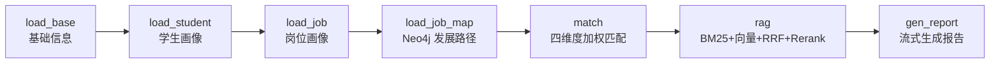
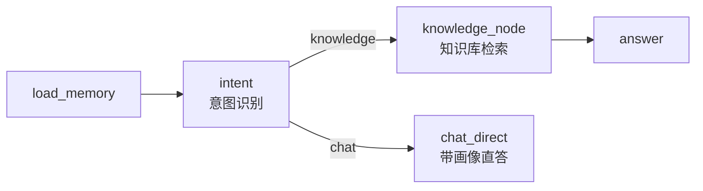

# CPA — Career Planning Agent（智能职业规划助手）

基于 **FastAPI + LangGraph + RAG + 知识图谱** 的 AI 职业规划与求职助手后端。

它做两件事：

1. **生成个性化职业规划报告** —— 结合学生画像、岗位画像、岗位发展路径图谱与行业知识库，流式输出一份可追溯、可润色、可管理的长文报告。
2. **多轮职业咨询对话** —— 带四层记忆（画像 / 长期向量记忆 / 会话摘要 / 窗口消息）的对话 Agent，自动做意图识别，命中知识库问题时走混合检索（BM25 + 向量 + RRF + Rerank）。

---

## ✨ 核心特性

| 模块 | 说明 |
| --- | --- |
| 用户体系 | 注册、密码登录、邮箱验证码登录，JWT 鉴权（bcrypt 加密密码） |
| 基础信息 / 学生画像 | 手动填写基本信息；粘贴文本或上传 PDF 简历，由 LLM 抽取结构化画像入库 |
| 岗位画像 | 从 Excel 岗位数据导入 MySQL，再由 LLM 归纳岗位画像（技能、素养、发展潜力等） |
| 岗位发展图谱 | Neo4j 中构建「岗位 → 技能」节点及 `PROMOTE`（晋升）/ `SWITCH`（换岗）关系 |
| 人岗匹配 | 纯算法（不调 LLM）的四维度加权匹配：基础要求 0.15 / 职业技能 0.35 / 职业素养 0.30 / 发展潜力 0.20 |
| 知识库 RAG | BM25 稀疏检索 + 向量稠密检索 → RRF 融合 → BGE Reranker 重排，本地 SentenceTransformer / HuggingFace 向量模型 |
| 报告生成 | LangGraph 七节点流水线，SSE 流式输出；支持历史列表、详情、AI 润色、删除 |
| 对话 Agent | LangGraph 条件边意图路由；Redis 会话窗口 + Chroma 长期记忆 + 自动摘要 |

---

## 🛠 技术栈

| 分类 | 选型 |
| --- | --- |
| Web 框架 | FastAPI、Uvicorn、Starlette（SSE `StreamingResponse`） |
| 编排 | LangGraph（StateGraph / MemorySaver / 条件边） |
| LLM | LangChain-OpenAI `ChatOpenAI`（兼容 OpenAI 协议，可接 DeepSeek、通义、本地 vLLM 等） |
| 关系库 | MySQL（PyMySQL） |
| 图数据库 | Neo4j（langchain-neo4j） |
| 缓存 | Redis（业务 db0 / 会话窗口 db1） |
| 向量库 | ChromaDB（langchain-chroma） |
| 检索 | rank_bm25 + jieba（BM25）、RRF 融合、FlagEmbedding FlagReranker（BGE Reranker） |
| 向量模型 | 本地 SentenceTransformer / HuggingFaceEmbeddings |
| 鉴权 | python-jose（JWT）、passlib[bcrypt] |
| 文档解析 | pdfplumber（简历）、pandas + xlrd（岗位 Excel） |
| 配置 | python-dotenv |

---

## 📁 目录结构

```
CPAproject/
├── main.py                     # FastAPI 入口，注册全部子路由 + CORS
├── common/                     # 基础设施
│   ├── MysqlCommon.py          # MySQL 连接
│   ├── Noe4jCommon.py          # Neo4j 连接
│   ├── RedisCommon.py          # Redis 连接
│   ├── JwtCommon.py            # JWT 签发/校验/依赖注入
│   ├── ModelCommon.py          # LLM 单例
│   └── ResponseCommon.py       # 统一响应封装
├── user/                       # 注册 / 登录 / 验证码
├── userprofile/                # 基础信息、学生画像、PDF 简历解析
├── jobprofile/                 # 岗位数据导入 MySQL、LLM 生成岗位画像
├── jobmap/                     # Neo4j 岗位-技能图谱构建与查询
├── rag/                        # 知识库：加载、切分、向量化、混合检索
│   ├── service/RetrieveService.py
│   └── util/                   # BM25 / RRF / Rerank / Embedding / Chroma
├── agent/                      # 职业规划报告流水线（LangGraph）
│   ├── graph/CareerGraph.py
│   ├── nodes/                  # load_base→load_student→load_job→load_job_map→match→rag→gen_report
│   └── util/MatchUtil.py       # 四维度人岗匹配算法
├── chatagent/                  # 职业咨询对话 Agent（LangGraph）
│   ├── graph/ChatGraph.py      # load_memory→intent→(knowledge|chat_direct)→answer
│   └── memory/                 # SimpleMemory 四层记忆 + MemoryUpdate
├── prompt/                     # YAML 提示词模板 + 加载器
├── datasets/                   # 行业/岗位知识库（Markdown）
├── 岗位数据.xls                 # 岗位原始数据
├── chroma_career/              # 岗位知识库向量库（运行时生成）
└── chroma_memory/              # 对话长期记忆向量库（运行时生成）
```

---

## 🚀 快速开始

### 1. 环境要求

- Python 3.10+
- MySQL 5.7+ / 8.0
- Redis 5.0+
- Neo4j 4.x / 5.x
- （可选）GPU 环境用于加速 Reranker 与向量模型；CPU 也可运行

### 2. 安装依赖

```bash
python -m venv .venv
.venv\Scripts\activate        # Windows
# source .venv/bin/activate   # Linux / macOS

pip install -r requirements.txt
```

### 3. 配置 `.env`

在项目根目录创建 `.env`（**不要提交到仓库**）：

```ini
# ===== LLM（OpenAI 协议兼容） =====
API_KEY=sk-xxxxxx
BASE_URL=https://api.openai.com/v1
MODEL_NAME=gpt-4o-mini

# ===== MySQL =====
MY_HOST=127.0.0.1
MY_PORT=3306
MY_USER=root
MY_PASSWORD=your_password
MY_DATABASE=career
MY_CHARSET=utf8mb4

# ===== Redis =====
REDIS_HOST=127.0.0.1
REDIS_PORT=6379
REDIS_DB=0

# ===== Neo4j =====
NEO4J_URL=bolt://127.0.0.1:7687
NEO4J_USERNAME=neo4j
NEO4J_PASSWORD=your_password
NEO4J_DATABASE=neo4j

# ===== JWT =====
SECRET_KEY=change_me_to_a_random_string
ALGORITHM=HS256
EFFECTIVE_TIME=1440          # token 有效分钟数

# ===== 向量库 / 本地模型 =====
CHROMA_PATH=./chroma_career
COLLECTION_NAME=career_kb
EMBEDDING_MODEL_PATH=./models/bge-small-zh-v1.5
RERANK_MODEL_PATH=./models/bge-reranker-base
MEMORY_EMBEDDING_MODEL_PATH=./models/bge-small-zh-v1.5

# ===== 邮箱验证码（SMTP） =====
SENDER_EMAIL=your_email@example.com
SENDER_EMAIL_PASSWORD=your_smtp_auth_code
SMTP_HOST=smtp.qq.com
SMTP_PORT=465
```

> 说明：`EMBEDDING_MODEL_PATH` / `RERANK_MODEL_PATH` / `MEMORY_EMBEDDING_MODEL_PATH` 均指向**本地模型目录**（HuggingFace 格式），也可直接填 HuggingFace 仓库名（如 `BAAI/bge-small-zh-v1.5`）。

### 4. 初始化数据

```bash
# 1) 导入岗位原始数据到 MySQL（TRUNCATE 后重建 job_position 表）
python jobprofile/dao/JobProfileDao.py

# 2) 构建 Neo4j 岗位-技能图谱
python -c "from jobmap.service.JobMapService import save_noe; print(save_noe())"

# 3) 构建岗位知识库向量库（读取 datasets/*.md）
python rag/util/DataLoadUtil.py
```

### 5. 启动服务

```bash
python main.py
# 或
uvicorn main:app --host 0.0.0.0 --port 8000 --reload
```

交互式文档：<http://localhost:8000/docs>

---

## 📡 API 一览

> 除注册/登录/图谱查询外，接口均需在 Header 中携带 `Authorization: Bearer <token>`。

### 用户 `/user`

| 方法 | 路径 | 说明 |
| --- | --- | --- |
| POST | `/user/register` | 注册账号 |
| POST | `/user/login` | 密码登录 |
| POST | `/user/sendcode` | 发送邮箱验证码 |
| POST | `/user/checkcode` | 校验验证码登录 |

### 基础信息 `/info`

| 方法 | 路径 | 说明 |
| --- | --- | --- |
| POST | `/info/info_save` | 保存基本信息（含目标岗位 `job_direction`） |
| GET | `/info/info_query` | 查询基本信息 |

### 学生画像 `/profile`

| 方法 | 路径 | 说明 |
| --- | --- | --- |
| POST | `/profile/ai_profile` | 文本 → LLM 结构化画像 |
| GET | `/profile/query_profile` | 查询画像 |
| POST | `/profile/upload_resume` | 上传 PDF 简历并抽取画像 |

### 岗位图谱 `/jobprofile`

| 方法 | 路径 | 说明 |
| --- | --- | --- |
| GET | `/jobprofile/job_paths?job_name=` | 查询某岗位的晋升/换岗路径 |
| GET | `/jobprofile/job_list` | 岗位名称列表 |

### 职业规划报告

| 方法 | 路径 | 说明 |
| --- | --- | --- |
| GET | `/reportplan/generate_report?target_position=` | SSE 流式生成报告（缺省取用户目标岗位） |
| GET | `/careerplan/report_list` | 历史报告列表 |
| GET | `/careerplan/report_detail?report_id=` | 报告详情 |
| POST | `/careerplan/report_polish?report_id=` | AI 润色报告 |
| POST | `/careerplan/report_delete?report_id=` | 删除报告 |

### 对话 `/chat`

| 方法 | 路径 | 说明 |
| --- | --- | --- |
| GET | `/chat/chat?question=&sessionId=` | SSE 流式对话 |
| POST | `/chat/saveConversation` | 保存一轮对话 |
| GET | `/chat/historyMenu` | 会话列表 |
| GET | `/chat/queryOneHistory?sessionId=` | 单个会话历史 |
| GET | `/chat/deleteOneHistory?sessionId=` | 删除会话 |

---

## 🔄 流程说明

### 职业规划报告流水线



### 对话 Agent 与四层记忆



四层记忆：

1. **用户画像**：MySQL 中的基本信息 + 学生画像（长期、结构化）
2. **长期记忆**：Chroma 向量库，按语义召回历史对话要点
3. **会话摘要**：LLM 滚动压缩的会话总结
4. **窗口记忆**：Redis 中最近若干轮原始消息

---

## ⚠️ 部署前建议

- 将 `main.py` 中的 CORS `allow_origins`（当前为 `http://localhost:8080`）外置为环境变量。
- `rag/util/DataLoadUtil.py` 与 `jobprofile/dao/JobProfileDao.py` 中目前是**硬编码的本地绝对路径**，上线前请改为相对路径或配置项。
- `.env`、`chroma_career/`、`chroma_memory/`、`*.xls` 等已加入 `.gitignore`，请勿提交密钥与本地数据。
- 仓库中暂未包含建表 SQL，请按各 DAO 中的字段名自行建库建表，或补充 `sql/` 目录。

---

## 📄 License

MIT License.
